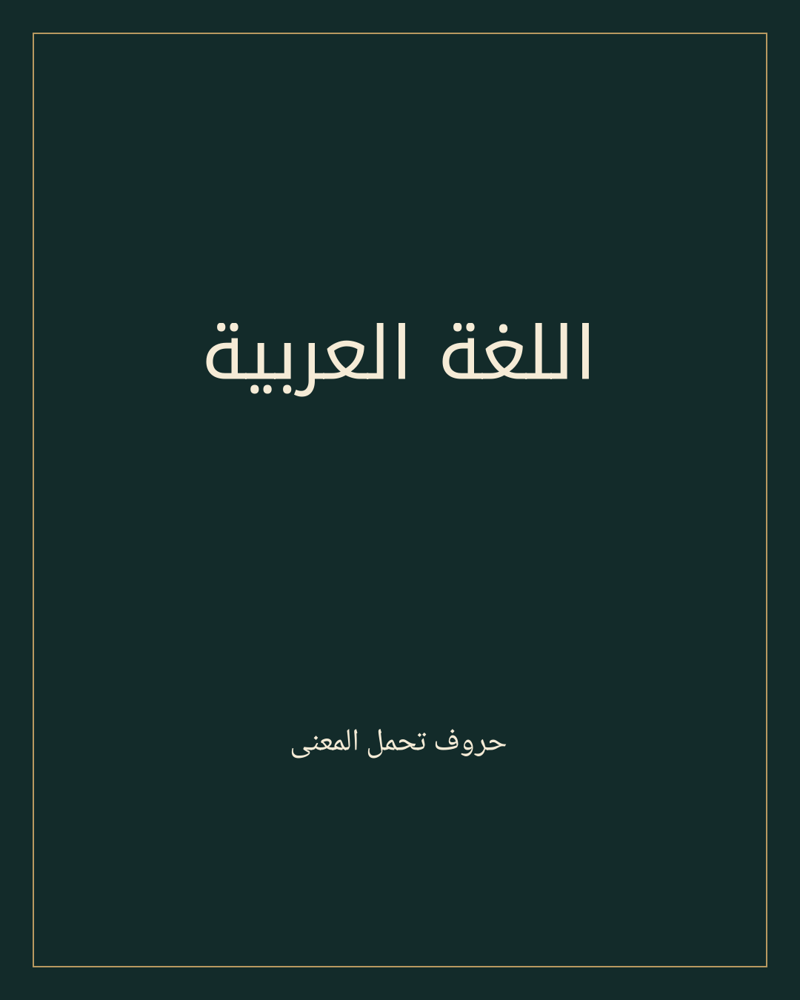

# الخط العربي لوكلاء الذكاء الاصطناعي

**٢٠ تقليداً من تقاليد الخط العربي، ومهارة واحدة قابلة لإعادة الاستخدام.**

[English](README.md) · [التثبيت](docs/installation.md) · [نتائج الدقة](ACCURACY.md)



يوفّر المشروع تنضيداً عربياً محلياً باستخدام Pango وHarfBuzz وCairo، مع تصدير PNG وSVG وPDF. يشمل الدليل عشرين تقليداً، لكن التنفيذ الحالي يدعم التنضيد بخطوط Noto للنسخ والكوفي والنستعليق فقط. لا تعني هذه النتائج اعتماداً فنياً من خطاط متخصص.

## التثبيت والاستخدام

يتطلب Python 3.11 أو أحدث على Linux، مع مكتبات Pango وCairo وFontconfig. اتبع [تعليمات التثبيت](docs/installation.md)، ثم:

```bash
python -m pip install .
arabic-calligraphy render --text "العلم نور" --style naskh --output artwork.svg
arabic-calligraphy poster --text "اللغة العربية" --style kufic --output poster.png
arabic-calligraphy document --input examples/documents/report.md --output report.pdf
```

بعد دمج فرع التطوير، يمكن تجربة أمر تثبيت المهارة التالي مع صلاحية الوصول إلى المستودع:

```bash
npx skills add akin-demir/arabic-calligraphy-skill
```

تثبيت المهارة لا يثبّت تلقائياً حزمة Python أو المكتبات الأصلية. لم يُتحقق بعد من الإدراج في skills.sh أو من تنفيذ هذا الأمر من المستودع البعيد.

## الإمكانات والحدود

| النمط | التنفيذ | الحالة الفنية |
|---|---|---|
| النسخ | Noto Naskh Arabic | اجتاز اختبارات العرض المحلية |
| الكوفي المعاصر | Noto Kufi Arabic | اجتاز اختبارات العرض المحلية |
| النستعليق | Noto Nastaliq Urdu | اجتاز اختبارات العرض المحلية |
| التقاليد السبعة عشر الأخرى | مراجع تعليمية فقط | غير منفذة |

التصنيف العام للأنماط المنفذة هو «تقريبي» لأن العمل طباعي ولم يخضع لاعتماد خطاط. الطغراء تقليد تركيبي وشعار خطي، وليست أبجدية مستقلة. ولا يغني خط كوفي جاهز عن تصميم كوفي مربع مدروس.

تعمل الملصقات والشهادات والمستندات متعددة الصفحات، مع فحص التغطية والهوامش والتحذير عند استخدام خط بديل للحروف اللاتينية. يحافظ SVG على أشكال الحروف كمسارات، ويحتفظ بالنص الأصلي في الوصف. تضمّن ملفات PDF الخطوط وتربطها بالنص المنطقي، لكن النسخ والاستخراج يختلفان باختلاف القارئ؛ لذلك ما زال الإصدار العام محجوباً ببوابة الجودة.

اجتاز التنفيذ ٣٧٤ اختباراً محلياً، منها ١١٣ حالة Unicode عبر ثلاثة خطوط. هذه الاختبارات لا تثبت الأصالة الخطية أو خلو جميع التراكيب من تزاحم العلامات. انظر [معرض النتائج](examples/gallery) و[التقرير الفني](ACCURACY.md).

لا يدعم المشروع استبدال النص في PDF موجود، أو تنفيذ HTML، أو إنشاء تراكيب ثلث وديواني وطغراء أصيلة آلياً. تراخيص الخطوط مستقلة عن ترخيص البرنامج MIT.

[المساهمة](CONTRIBUTING.md) · [الأمان](SECURITY.md) · [تراخيص الخطوط](FONT_LICENSES.md) · [خطة التطوير](docs/roadmap.md)

## المرشح التجريبي الأول وخطة التطوير

أذن مالك المستودع بإتاحة المرشح v0.1.0-rc.1 للتجربة مع توضيح مشكلة استخراج النص العربي من PDF. يظل الإصدار المستقر محجوباً حتى حل المشكلة. انظر [ملاحظات المرشح الأول](docs/releases/v0.1.0-rc.1.md) و[خطة المرشح التالي](docs/next-candidate.md).
