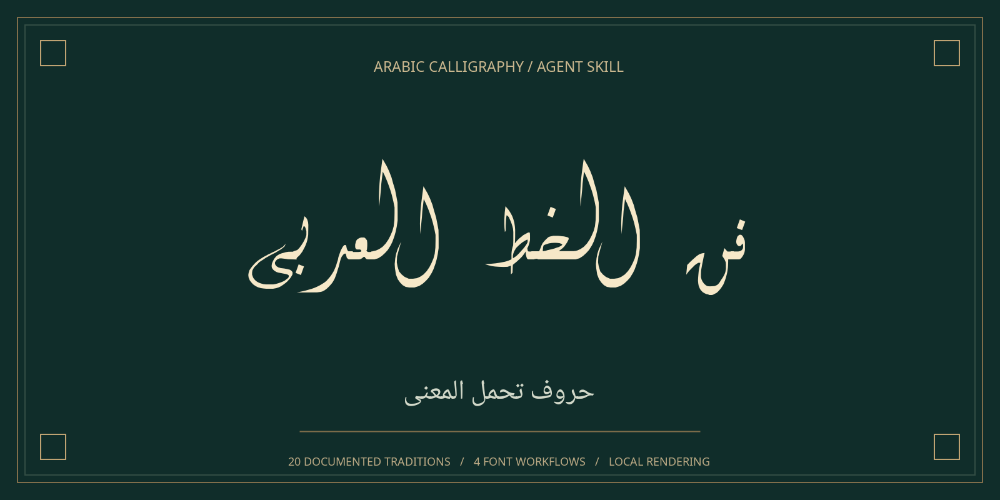
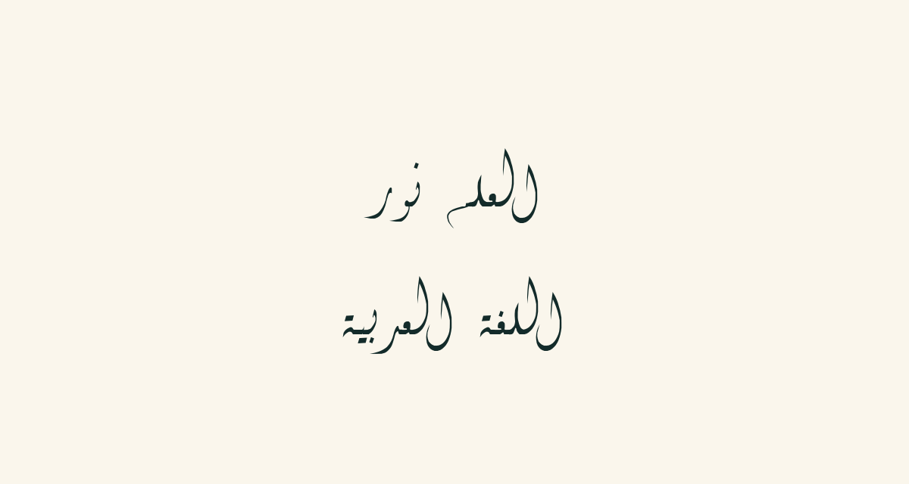
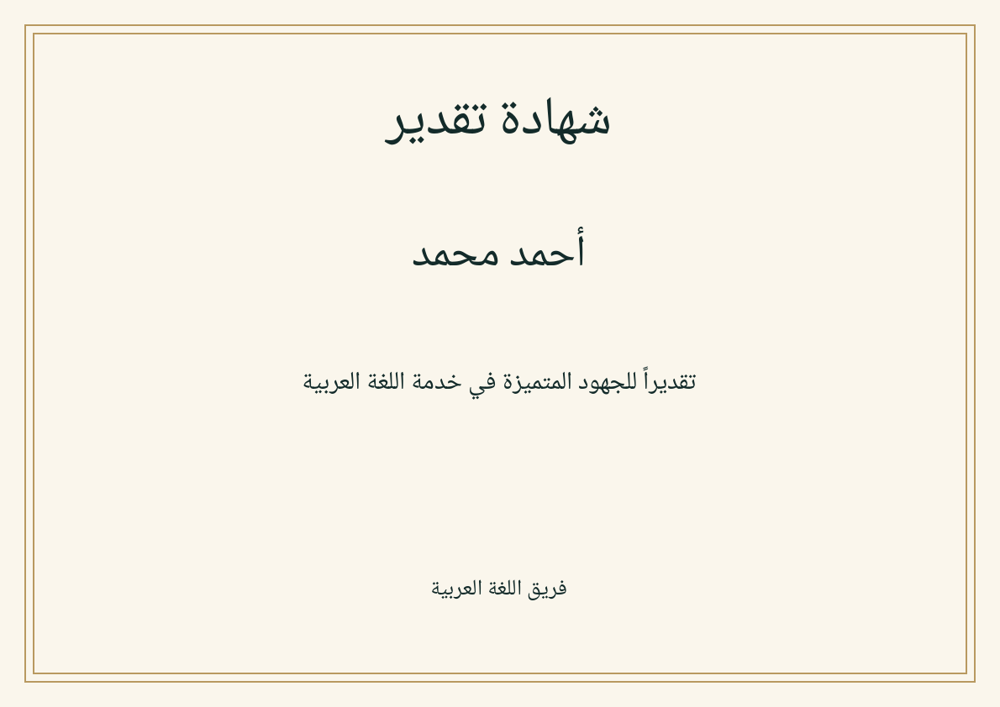

<div align="center">

# Arabic Calligraphy for AI Agents

**20 Arabic calligraphy traditions. One reusable AI skill.**

Arabic lettering, artwork and documents — rendered locally with open fonts.

[Download RC2](https://github.com/akin-demir/arabic-calligraphy-skill/releases/tag/v0.1.0-rc.2) · [Get started](#install) · [Gallery](#real-output-gallery) · [العربية](README.ar.md)

[](https://github.com/akin-demir/arabic-calligraphy-skill/actions/workflows/quality.yml)

</div>

[](examples/gallery/readme-hero.svg)

<p align="center"><em>Real output from Layla Diwani. <a href="examples/gallery/readme-hero.svg">View the outlined SVG</a> · <a href="scripts/generate_gallery.py">Reproduce the artwork</a></em></p>

| Create artwork | Typeset documents | Work with your agent |
| :--- | :--- | :--- |
| Diwani lettering, posters and transparent wordmarks in PNG/SVG. | Naskh-based reports, certificates and multipage PDFs. | Portable skill instructions, a local CLI and a Python API. |

**Try it now:** [Download the RC2 skill ZIP](https://github.com/akin-demir/arabic-calligraphy-skill/releases/download/v0.1.0-rc.2/arabic-calligraphy-skill-rc2.zip) · [Installation](docs/installation.md) · [CLI & API](docs/usage.md)

> **Experimental RC2:** four font workflows and twenty documented traditions. Diwani is limited to unvocalized PNG/outlined SVG. PDF text extraction remains reader-dependent. [Capabilities](#capability-matrix) · [Accuracy](ACCURACY.md) · [Release notes](docs/releases/v0.1.0-rc.2.md) · [RC3 plan](docs/next-candidate.md)

## What works

- Offline Pango/HarfBuzz shaping and bidi layout; Cairo PNG, outlined SVG and native PDF output.
- Unicode Arabic, marks, lam-alif, mixed Latin text, multiline wrapping, alignment, colors and transparency.
- Measured posters, transparent wordmarks, landscape certificates and paginated new PDF documents with headings and page numbers.
- Bundled Noto and Layla Diwani fonts with exact hashes, license notices, coverage checks and explicit Latin fallback warnings.
- 470 passing local checks: the existing 113-input corpus across three Noto fonts, 89 unmarked inputs for Diwani, export/coverage/refusal tests and visual comparisons. Diwani supports PNG/SVG only; existing PDF tests cover the Noto workflows.

These workflows produce typography. Custom Thuluth, Diwani Jali, Tughra and geometric Kufic compositions require specialist manual work. A font name cannot establish authenticity.

## Install

Requires Python 3.11+ and Linux Pango/Cairo/Fontconfig. See [native setup](docs/installation.md).

```bash
git clone https://github.com/akin-demir/arabic-calligraphy-skill.git
cd arabic-calligraphy-skill
git switch --detach v0.1.0-rc.2
python -m venv .venv
. .venv/bin/activate
python -m pip install .
arabic-calligraphy render --text "العلم نور" --style naskh --output artwork.svg
```

Agent skill installation target (requires authenticated Git access while this repository is private):

```bash
npx skills add akin-demir/arabic-calligraphy-skill --skill arabic-calligraphy-skill
```

For a version-pinned trial, install from the tagged local checkout with `npx skills add . --skill arabic-calligraphy-skill`. Skill installation does not install Python/native dependencies. CLI installation and skills.sh listing have not been verified remotely. See [agent compatibility](docs/compatibility.md).

## Ask your agent

“Use the bundled renderer to create Diwani lettering saying العلم نور. Deliver PNG and outlined SVG files.”

«أنشئ شهادة تقدير باسم أحمد محمد، بخط نسخي واضح، واحفظها بصيغة PDF مع مراجعة النص والهوامش.»

## Real output gallery

All files below were generated by [generate_gallery.py](scripts/generate_gallery.py).

<table>
<tr>
<td width="50%" align="center"><a href="examples/gallery/diwani.svg"></a><br><strong>Diwani lettering</strong><br>Unvocalized, outlined SVG and PNG.</td>
<td width="50%" align="center"><a href="examples/gallery/certificate.pdf"></a><br><strong>Arabic certificates</strong><br>Measured Naskh layout with embedded-font PDF.</td>
</tr>
</table>

| Typography | Preview | Vector | PDF |
|---|---|---|---|
| Naskh | [PNG](examples/gallery/naskh.png) | [SVG](examples/gallery/naskh.svg) | [PDF](examples/gallery/naskh.pdf) |
| Modern Kufic | [PNG](examples/gallery/kufic.png) | [SVG](examples/gallery/kufic.svg) | [PDF](examples/gallery/kufic.pdf) |
| Nastaliq Urdu type | [PNG](examples/gallery/nastaliq.png) | [SVG](examples/gallery/nastaliq.svg) | [PDF](examples/gallery/nastaliq.pdf) |
| Diwani | [PNG](examples/gallery/diwani.png) | [SVG](examples/gallery/diwani.svg) | Unsupported |
| Diwani poster | [PNG](examples/gallery/diwani-poster.png) | [SVG](examples/gallery/diwani-poster.svg) | Unsupported |
| Poster | [PNG](examples/gallery/poster.png) | [SVG](examples/gallery/poster.svg) | [PDF](examples/gallery/poster.pdf) |
| Certificate | [PNG](examples/gallery/certificate.png) | [SVG](examples/gallery/certificate.svg) | [PDF](examples/gallery/certificate.pdf) |

Also: [transparent wordmark](examples/gallery/wordmark.svg), [marks and mixed text](examples/gallery/typography.png), [Arabic report](examples/gallery/report.pdf).

## Capability matrix

| Catalog entries | Font/workflow | Public classification | Technical checks | Expert authenticity |
|---|---|---|---|---|
| Naskh | Noto Naskh Arabic | Approximate | Local font/render/export tests pass | Not reviewed |
| Kufic | Noto Kufi Arabic | Approximate | Local font/render/export tests pass | Not reviewed |
| Nastaliq | Noto Nastaliq Urdu | Approximate | Local font/render/export tests pass | Not reviewed |
| Diwani | LaylaDiwani Regular | Approximate | Unvocalized PNG/outlined SVG; PDF/harakat refused | Not reviewed |
| Other 16 traditions | No integrated font/workflow | Reference Only | No implementation | Not reviewed |

See all twenty names and individual research notes in [capabilities.json](capabilities.json). Variants, regional families and emblem composition traditions overlap; these are not twenty independent alphabets. Some introductory historical entries are explicitly provisional.

## CLI and Python

```bash
arabic-calligraphy poster --text "اللغة العربية" --style kufic --size 1080x1350 --output poster.png
arabic-calligraphy certificate --recipient "أحمد محمد" --body "تقديراً للجهود المتميزة" --output certificate.pdf
arabic-calligraphy document --input examples/documents/report.md --body-style naskh --output report.pdf
arabic-calligraphy styles
```

```python
from arabic_calligraphy.engine import render
from arabic_calligraphy.layouts import document

render("أهلاً وسهلاً", "welcome.svg", style="naskh", align="center")
document("# تقرير\nالعلم نور", "report.pdf")
```

See [all supported options and units](docs/usage.md). Diwani uses an unchanged OFL font with a restrictive embedding flag and no GPOS: PDF and combining marks are explicitly refused. It does not generate interwoven Diwani Jali or Al Jazeera-like emblems. SVG glyphs are outlines with exact source text in a description element. PDFs embed font subsets and associate logical source text with drawn glyphs using ActualText. Some readers ignore that mapping or reorder Arabic; lossless copy/paste is not guaranteed. Existing PDF text replacement is not implemented.

## Quality, development and limitations

```bash
python -m pip install '.[dev]'
python scripts/check_project.py
PYTHONPATH=src python -m unittest discover -s tests -v
PYTHONPATH=src python scripts/verify_accuracy.py
PYTHONPATH=src python scripts/generate_gallery.py
```

See [ACCURACY.md](ACCURACY.md) for exactly what the tests prove and the blocked release gate. Raster references use bundled fonts; native library differences can affect antialiasing. Human inspection was performed on the poster, Naskh and Nastaliq samples; no calligrapher review was performed.

Linux is the supported runtime. Text is limited to 100,000 characters, canvases to 32 million pixels and documents to 200 pages. Overflow and missing coverage fail explicitly. This small renderer supports plain text and Markdown headings, not a full publishing system, arbitrary PDF editing or automatic classical compositions. Public Python rendering calls should be serialized because Fontconfig configuration is process-global.

[Architecture](docs/architecture.md) · [Contribute](CONTRIBUTING.md) · [Roadmap](docs/roadmap.md) · [Security](SECURITY.md) · [Font licenses](FONT_LICENSES.md) · [Changelog](CHANGELOG.md) · [Release process](RELEASE.md) · [GitHub setup](GITHUB_SETUP.md)

Code: MIT. Font designs remain their authors' property under OFL. Thanks to the Noto, Pango, HarfBuzz, Cairo, Fontconfig, fontTools, pypdf and Agent Skills communities. Historical sources are linked per tradition; museum specimens are references, not bundled artwork.
