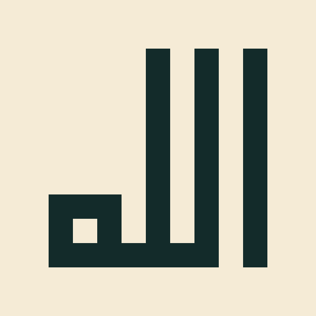

# Manual Square Kufic studies

Development preview: a deterministic grid exporter for manually composed artwork.
It does not convert arbitrary Arabic into Square Kufic, pack words into an emblem,
or establish authenticity. `render --style square-kufic` remains unavailable.



This original `الله` study uses a 9×9 grid. The separate alif is at the right;
two lams join along the lower baseline to the final heh at the left. Blank space
above the heh is intentional in this simple study. This is not the tightly packed,
interlocking composition shown in the user's reference. Review the spelling and
letterforms before treating the sample as approved artwork.

From this branch's installed package, or with `PYTHONPATH=src` before each command:

```bash
python -m arabic_calligraphy.cli grid --input examples/square-kufic/allah-study.json
python -m arabic_calligraphy.cli grid --input examples/square-kufic/allah-study.json --output study.svg
python -m arabic_calligraphy.cli grid --input examples/square-kufic/allah-study.json --output study.png --unit 64
```

## Editable format

The JSON uses `format: square-kufic-grid-v1`, exact original Unicode `text`,
`letters`, and rectangular `rows`. A period is an empty cell. Every other cell
contains a case-sensitive ASCII letter/digit ID from `letters`. Rows run top to
bottom; columns run left to right in physical canvas coordinates. Do not reverse
or reshape the source text. Author the geometry directly; do not rasterize a
generic font or invent maze patterns and label them Arabic.

Each letter record has `id`, `start`, `end`: zero-based Python Unicode character
offsets into `text`, with the end excluded. A record can cover a ligature. Spans
must not overlap, and all non-whitespace source characters must be represented.
Every ID must have cells. This records the author's intended reading; it cannot
prove those cells actually depict that letter. Dots, hamza and diacritics must
be represented explicitly with their corresponding source span. Never silently
drop them or invent ornamental dots to fill holes.

Use `--unit` for the integer pixel width/height of every cell and `--padding` for
the number of empty cells around the grid. Both strokes and empty cells use this
same unit. Colors accept the existing renderer's hex/transparent syntax. Export
uses Cairo filled rectangles, without font substitution, smoothing or scaling
letters. The SVG description includes the exact source, labeled rows and mapping;
PNG is visual artwork, with the JSON retained as its audit companion. PDF export
is intentionally unsupported for this new workflow.

## Checks and review

Inspection reports solid 2×2 blocks (uneven weight in this one-cell study mode),
corner-only 2×2 contacts, empty 2×2 patches and whether both dimensions are odd.
Export refuses the first two findings. Empty patches and even dimensions are
reported for composition review, not treated as universally forbidden. Inspection
returns a failing exit code for refused geometry. JSON is limited to 1 MB, text
to 512 characters, grids to 129×129, output to 8192 pixels per side and 32 million
pixels. Existing output is preserved when validation fails.

Passing checks does not verify Arabic spelling, correct joining, right-to-left
reading order, recognizable letterforms, uniform negative space, packed-square
composition or historical authenticity. Review the source map against the actual
image letter by letter. No independent calligrapher review has been recorded.

## Next composition work

1. Get visual review of this small study and correct the letter grid as needed.
2. Design and review a packed composition, with explicit word turns, reading path
   and no extra filler strokes. Preserve exact text in a source map throughout.
3. Build a licensed, reviewed contextual-letter library and joining constraints
   before offering automatic text composition. Keep unsupported text explicit.

Research references: [Mamoun Sakkal's Square Kufic alphabet notes](https://www.sakkal.com/instrctn/sq_kufi_alphabet.html)
explain grid alignment, contextual forms and connection widths;
[the practical Square Kufic rules guide](https://squarekufic.app/guide/square-kufic-rules)
separates geometric checks from Arabic review. Neither site's charts or glyph
artwork are redistributed here. The sample and exporter are original project work.
